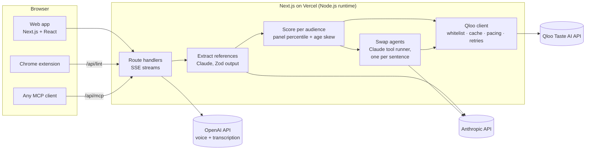
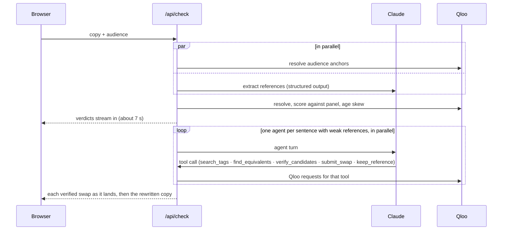

<p align="center">
  <picture>
    <source media="(prefers-color-scheme: dark)" srcset="docs/brand/logo-dark.png" />
    
  </picture>
</p>

<p align="center"><strong>The spell-checker for culture.</strong><br />
Every artist, show, film, brand and place in your copy, scored for the exact audience you're writing for on Qloo's taste graph, and the ones that miss swapped for verified equivalents that land.</p>

<p align="center">
  <a href="https://vernacular-lime.vercel.app"><b>Live demo</b></a> ·
  <a href="https://vernacular-lime.vercel.app/benchmark">Benchmark</a> ·
  <a href="https://vernacular-lime.vercel.app/pitch">Why Vernacular</a> ·
  <a href="#run-it-locally">Run it locally</a>
</p>

<p align="center">
  
  
  
  
  
</p>

---

## Links

| What | Link |
|---|---|
| Live demo (no sign-in; opens on a real, cached check) | https://vernacular-lime.vercel.app |
| Culture Translator: one reference, five audiences | https://vernacular-lime.vercel.app/translate |
| Vernacular Anywhere: the browser extension's check, in mock composers | https://vernacular-lime.vercel.app/anywhere |
| Benchmark: Vernacular vs Claude alone, every pair browsable | https://vernacular-lime.vercel.app/benchmark |
| How it works: the pipeline, the scoring method, what we learned | https://vernacular-lime.vercel.app/how |
| Why Vernacular: the problem, the product, the business | https://vernacular-lime.vercel.app/pitch |
| MCP server for AI agents (for MCP clients; a browser gets a 406) | https://vernacular-lime.vercel.app/api/mcp |
| Source code | https://github.com/TusharTechs/vernacular |
| Browser extension (load unpacked) | [`extension/`](extension) |
| Qloo Agentic Hackathon | https://qloo.devpost.com |
| Qloo API documentation | https://docs.qloo.com |

## Contents

[What it does](#what-it-does) · [Qloo, used unusually](#qloo-used-unusually) · [Screenshots](#screenshots) · [Features](#features) · [How it uses Qloo](#how-it-uses-qloo) · [Architecture](#architecture) · [Engineering notes](#engineering-notes) · [Evidence](#evidence) · [Tech stack](#tech-stack) · [Project structure](#project-structure) · [HTTP API](#http-api) · [MCP](#use-it-from-an-agent-mcp) · [Extension](#browser-extension) · [Run it locally](#run-it-locally) · [Data and privacy](#data-and-privacy) · [AI disclosure](#ai-disclosure) · [License](#license)

## What it does

1. **Finds the references.** Claude reads the copy (or storyboard frames, or a video ad's frames and voiceover) and extracts every named cultural reference with the role it plays in its sentence.
2. **Scores them on Qloo.** Each reference is resolved on Qloo and ranked against about 40 well-known peers of the same type *for this audience*: its taste anchors, age band, Qloo audience segments and interest tags. Raw affinity isn't comparable across audiences, so the score is a within-audience percentile, then adjusted for the reference's demographic age skew. Lands is p65 or above, misses is below p35.
3. **Swaps the weak ones.** A Claude agent with Qloo tools finds equivalents the audience over-indexes on, verifies each one with the same scoring, picks the one that plays the same role, and rewrites only the words it needs. Each swap carries Qloo's explainability: which of the audience's favourites pulled it in.

## Qloo, used unusually

Eight things Vernacular does with Qloo that a recommendations call alone wouldn't give you. Every screenshot is from the running app.

<table>
<tr>
<td width="50%" valign="top">

**1. A dictionary for a spell-checker.** Raw affinity isn't comparable across audiences, so each reference is ranked against ~40 well-known peers scored for the same audience in the same request. That turns affinity into a verdict a writer can act on (lands, mixed, misses), adjusted by Qloo's demographic age skew.

**2. Explainability you can see.** Qloo's `feature.explainability` becomes a *taste path*: which of the audience's favourites pulled each swap in, and by how much.

</td>
<td width="50%"></td>
</tr>
<tr>
<td valign="top">

**3. Taste on a timeline.** In the Dial Test, Qloo percentiles are placed on the exact words where each reference is spoken, so you hear and watch Olive Garden sink and Kali Uchis land.

</td>
<td></td>
</tr>
<tr>
<td valign="top">

**4. Audiences you can read.** Predicted commenters are built from Qloo: each one's favourite artist, show, film and brand comes from Qloo for this audience, and how they react to each reference has to match its Qloo score.

</td>
<td></td>
</tr>
<tr>
<td valign="top">

**5. Heatmaps for creative placement.** Qloo's locality heatmaps, drawn from Qloo's own neighbourhood boundaries, compare where an audience lives with where each reference's fans live: Kali Uchis reaches 8 of Gen Z Latin-pop fans' 10 strongest Chicago neighbourhoods; Seinfeld reaches none.

</td>
<td></td>
</tr>
<tr>
<td valign="top">

**6. A dictionary between audiences.** The Culture Translator scores one reference for five audiences and, where it misses, finds the Qloo-verified equivalent that plays the same role: Seinfeld becomes *On My Block* for Gen Z Latin-pop fans and *Insecure* for 30–34 hip-hop heads.

</td>
<td></td>
</tr>
<tr>
<td valign="top">

**7. Qloo as the referee.** The benchmark uses Qloo to grade Claude alone against Vernacular on the same copy and briefs, and shows what a model does without taste data: it repeats the audience's own examples back.

**8. Taste in every text box and every agent.** The same Qloo-backed check runs in a browser extension on any page, and as MCP tools any AI agent can call before it publishes.

</td>
<td><br /></td>
</tr>
</table>

## Screenshots

| | |
|---|---|
|  |  |
| **Home.** A live ticker of real swaps, twelve one-click scenarios and a guided tour. | **Dark mode.** Every page has a light and a dark theme. |
|  |  |
| **A check.** Proof marks on each reference, Qloo evidence per card, and a bar to jump between results. | **How it works.** The pipeline, one show's standing across five audiences, and what we learned. |

## Features

| Feature | What it does |
|---|---|
| **Check** | Copy in, every reference marked lands / mixed / misses with the Qloo evidence behind it, verified swaps you accept or dismiss one by one. |
| **Real-world scenarios** | Twelve one-click cases across formats (event promo, podcast read, trailer voiceover, radio spot, email, launch post, short-video caption, Chicago billboard, App Store blurb, charity appeal, Spanish promo, LinkedIn post), each a real check cached on the server. |
| **Guided tour** | A 60-second walkthrough of the best moments for first-time visitors. |
| **Your checks** | Your recent checks, kept only in this browser, reopen instantly with their before and after scores. |
| **Dial Test** | The copy read aloud (AI voice, disclosed) while a reaction curve swings to each reference's Qloo percentile as it is spoken; then the swapped version. Words are timed by transcribing the generated audio. |
| **Predicted comments** | Five simulated commenters whose favourites come from Qloo for this audience, reacting in line with each reference's score, before and after swaps. Labelled as simulated. |
| **Where it lands** | Qloo locality heatmaps: the neighbourhoods of a city where the audience over-indexes, and how many of them each reference's fans also live in, drawn from Qloo's own boundaries. |
| **Culture Translator** | One reference scored for five audiences; where it misses, the verified equivalent that plays the same role, on a streaming radial compass. |
| **Tour Mode** | The same copy against two to five audiences side by side. |
| **Audience from a sentence** | A plain description becomes Qloo audience segments, interest tags and anchors, with a cross-domain fingerprint. |
| **Storyboards and video** | Frames are sampled in the browser; Claude reads on-screen brands, settings and text; the voiceover is transcribed and each line attached to its frame. |
| **Social layer** | Shareable result cards with social previews, swipe review of swaps, and a feed preview that marks the fold. |
| **Claude alone comparison** | The same model and brief without Qloo, scored the same way, side by side with Vernacular. |
| **Vernacular Anywhere** | A Chrome extension: a culture-check pill on any text box, one-click swaps that Undo can reverse, and a link into the full check. |
| **MCP server** | Five tools for any agent: `check_copy`, `build_audience`, `compare_audiences`, `where_it_lands`, `translate_reference`. |

## How it uses Qloo

Vernacular would not work without Qloo: the model writes, Qloo decides what lands. These are the Qloo endpoints the app calls at runtime:

| Qloo request | Parameters used | Powers |
|---|---|---|
| `GET /search` | `query`, `types`, `take`; matches checked against the name and Qloo's alternative names (`akas`) | Resolving every reference, anchor and candidate |
| `GET /v2/insights` (scoring) | `filter.type`, `filter.results.entities`, `signal.interests.entities`, `signal.demographics.age`, `signal.demographics.gender`, `signal.demographics.audiences`, `signal.interests.tags` | Scores for the references and a reference panel in the same request, so they're comparable |
| `GET /v2/insights` (panel) | `filter.type`, `filter.popularity.min`, `take=40`; `filter.location.query` for places in a city | The well-known peers a reference is ranked against |
| `GET /v2/insights` (candidates) | `feature.explainability`, `filter.tags`, `filter.exclude.entities`, `filter.popularity.min` | Swap candidates, and which anchors drove each one |
| `GET /v2/insights` (demographics) | `filter.type=urn:demographics` | Age skew that can downgrade a verdict |
| `GET /v2/insights` (location) | `signal.location.query` | Place and brand scores for an audience in a city |
| `GET /v2/insights` (heatmap) | `filter.type=urn:heatmap`, `filter.location.query`, `output.heatmap.boundary=urn:entity:locality` | Neighbourhood maps from Qloo's polygons |
| `GET /v2/audiences` | `filter.audience.types`, `take` | The segment catalogue for plain-language audiences |
| `GET /v2/tags` | `filter.query` | Role-preserving swaps ("sitcom", "crooner") and interest tags |

### A real trace

One run of the landing sample (*Gen Z Latin-pop fans*: anchors Bad Bunny and *Euphoria*, age 24 and younger): 30 Qloo calls, 9 Claude calls, 38 seconds. IDs are shortened here.

```text
GET /search?query=Seinfeld&take=3&types=urn:entity:tv_show
GET /v2/insights?filter.popularity.min=0.85&filter.type=urn:entity:tv_show&take=40        ← reference panel
GET /v2/insights?filter.results.entities=<Seinfeld, panel…>&filter.type=urn:entity:tv_show
                &signal.demographics.age=24_and_younger&signal.interests.entities=<Bad Bunny, Euphoria>&take=41
GET /v2/insights?filter.type=urn:demographics&signal.interests.entities=<Seinfeld>        ← age skew
GET /v2/insights?feature.explainability=true&filter.exclude.entities=<Seinfeld>&filter.popularity.min=0.6
                &filter.tags=urn:tag:subgenre:qloo:sitcom,urn:tag:keyword:qloo:sitcom
                &filter.type=urn:entity:tv_show&signal.demographics.age=24_and_younger
                &signal.interests.entities=<Bad Bunny, Euphoria>&take=8                    ← candidates
…

Seinfeld      → mixed  p40   "Scores higher with this audience than 40% of well-known peers of the same type."
Olive Garden  → misses p0
Frank Sinatra → mixed  p60   "Its audience over-indexes for 24 and younger (+0.35)."

Seinfeld      → iCarly      p98   drivers: Euphoria 50%, Bad Bunny 50%
Frank Sinatra → Kali Uchis  p100  drivers: Euphoria 51%, Bad Bunny 49%
```

Every Qloo call behind a result is listed in the app: open **"Qloo calls back what you see here"** under any check.

## Architecture



A check, step by step:



## Engineering notes

**The swap agent.** Built on the Anthropic SDK's tool runner with Zod-typed tools. Rules are enforced in the tools, not just the prompt:

- a candidate must have come from Qloo in this run;
- it must verify as landing, or be mixed and at least 15 points above the original;
- the rewritten sentence must name it (or its usual acronym) and no longer contain the original;
- each run has a cap of 16 model turns and 40 Qloo calls.

The prompt adds judgment the data can't make: keep references that state a fact (credits, venues, where something is sold), prefer household names when a reference is a yardstick ("funnier than X"), and switch type when like-for-like can't fill the role (a film for a director).

**Scoring.** A reference's affinity is compared with ~40 well-known entities of the same type scored in the same Qloo request. That makes scores comparable within one audience, which raw affinity isn't. With a city set, places are ranked among that city's well-known places, and anything still short of a comparison set is scored on taste alone, with a note saying so.

**Qloo client** (`src/lib/qloo/client.ts`):

- a parameter whitelist, because Qloo silently ignores unknown parameters;
- response caching (1 hour) and sharing of identical in-flight requests;
- at most three requests in flight, spaced to stay under the key's 5-requests-per-second limit;
- retries that honour `Retry-After`;
- a name-plausibility check, so a made-up name never borrows a real entity's score.

**Reliability:**

- Streams results as they're ready.
- Runs one agent per sentence in parallel.
- Queues requests for up to 20 seconds when an instance is busy, instead of failing.
- Serves gallery scenarios and the landing sample from a daily server cache that refreshes in the background.
- Strips unused Qloo tags from everything sent to the browser.
- Offers a ready-made example when a check fails.

**Front end:** React 19 Server and Client Components, Tailwind CSS v4 with light and dark themes, and SVG visualisations drawn by hand (no chart or map libraries): the Dial Test curve, the translator compass, taste paths and neighbourhood maps. Animations respect reduced-motion settings.

## Evidence

**Benchmark.** Run with `npm run benchmark`; results at [`/benchmark`](https://vernacular-lime.vercel.app/benchmark). It covers 8 pieces of original ad copy × 5 audiences, run on 2026-10-20. Each pair is written three ways: the original, Claude alone (same model and brief, no Qloo) and Vernacular. Every final text is graded by one pass (extract, then score on Qloo), plus a blind judge for meaning and fluency.

| | Original | Claude alone | Vernacular |
|---|---|---|---|
| Mean percentile | p51 | p73 | **p88** |
| References that miss | 49% | 24% | **4%** |
| Meaning kept (blind judge, /5) | | 4.65 | 4.60 |
| Reads naturally (blind judge, /5) | | 4.70 | 4.50 |

- Vernacular scored higher than Claude alone in 26 of 40 pairs (+14.4 points on average, 95% bootstrap interval 9.0 to 19.7).
- 36 of Claude alone's references simply repeated the audience examples from the brief, which score p100 by definition. Leaving those out of both sides, the gap is +27.3 points.
- Qloo is both Vernacular's source and the grader, so this measures the distance from what Qloo's data says about an audience, not human reactions. The benchmark page says so.
- The published run predates later changes: parallel agents, lower agent effort, the factual-reference rule, the name-plausibility check and city-local place scoring.

**Edge cases.** `npm run edge-cases -- --full` runs 16 cases live against Claude and Qloo, each with its expectation written in the script:

- no references, and generic nouns
- possessives, hashtags and handles, misspellings, emoji
- *Atlanta* the show vs the city, and Spanish copy
- prompt injection inside the copy
- made-up names
- the audience's own anchor
- a repeated name
- older references for a young audience
- swaps that keep Spanish copy in Spanish
- a factual credit that must not be swapped

All 16 pass.

**Unit tests.** 63 tests in 11 files (`npm test`): parameter whitelisting, scoring verdicts, the diff engine, share tokens, the benchmark statistics, Dial Test alignment, name plausibility, map geometry and payload slimming. GitHub Actions runs lint, typecheck, the tests and a production build on every push to `main`.

**Load.** `scripts/load-test.ts` fires simultaneous fresh checks as distinct visitors. Five at once on one server instance all completed: first scores in 8–10 seconds, all finished within 44 seconds.

**Accessibility.** axe-core 4.10 reports no violations on the main pages (`/`, `/translate`, `/benchmark`, `/anywhere`, `/how`, `/pitch`), and each fits a 375 px screen without sideways scrolling.

## Tech stack

| Layer | Choice (version) |
|---|---|
| Framework | Next.js 15.5 (App Router, Node.js runtime route handlers), React 19.1 |
| Language | TypeScript 5 |
| Styling | Tailwind CSS 4; Newsreader, Instrument Sans and JetBrains Mono via `next/font` |
| Taste data | Qloo Taste AI API (hackathon host) |
| Language model | Anthropic Claude `claude-opus-5-5` via `@anthropic-ai/sdk` 0.135 (structured outputs, tool runner) |
| Voice | OpenAI `gpt-4o-mini-tts` (Dial Test voice) and `whisper-1` (word and segment timestamps) |
| Agents | Model Context Protocol server, `@modelcontextprotocol/sdk` 1.32, Streamable HTTP |
| Validation | Zod 4 |
| Images | `next/og` for share cards |
| Testing | Vitest 5, live edge-case and load scripts |
| CI and hosting | GitHub Actions, Vercel |

## Project structure

```text
vernacular/
├── src/
│   ├── app/                      # Next.js App Router
│   │   ├── page.tsx              # Check (home)
│   │   ├── translate/            # Culture Translator
│   │   ├── anywhere/             # Extension demo
│   │   ├── benchmark/            # Benchmark results
│   │   ├── how/                  # How it works
│   │   ├── pitch/                # Why Vernacular
│   │   ├── c/[token]/            # Shared result page
│   │   └── api/                  # Route handlers (see HTTP API)
│   ├── components/               # UI: workbench, Dial Test, map, compass, tour…
│   └── lib/
│       ├── qloo/                 # Qloo client, parameter whitelist, tools, geometry, name matching
│       └── vernacular/           # Extraction, scoring, swap agent, translator, comments, voice,
│           ├── benchmark/        #   lint, scenarios; benchmark corpus, grader, judge, stats, results
│           └── __tests__/        # Unit tests
├── extension/                    # Chrome extension (Manifest V3)
├── public/                       # Extension script for the demo page, sample storyboard and animatic
├── scripts/                      # CLI check, benchmark, edge cases, load test, MCP smoke, sample media
├── docs/brand/                   # Logo files
├── docs/screenshots/             # README screenshots
└── .github/workflows/ci.yml      # Lint, typecheck, tests, build
```

## HTTP API

All routes are `POST` with JSON unless noted. Streaming routes send server-sent events.

| Route | Purpose |
|---|---|
| `/api/check` (SSE) | Full check: extract, score, swap |
| `/api/tour` (SSE) | Score one copy for 2–5 audiences |
| `/api/translate` (SSE) | One reference across five audiences |
| `/api/lint` | Fast check for the extension (CORS open) |
| `/api/audience` | Plain-language audience → Qloo signals |
| `/api/baseline` | Claude alone, scored the same way |
| `/api/map` | Neighbourhood heatmaps for a city |
| `/api/comments` | Predicted comments |
| `/api/voice` | AI voice with word timings |
| `/api/storyboard` | Read storyboard or video frames |
| `/api/transcribe` | Voiceover transcription (multipart) |
| `GET /api/sample`, `GET /api/scenario/:id` | Cached example checks |
| `GET /api/card?d=…` | Share-card image |
| `/api/mcp` (GET, POST, DELETE) | MCP server |

Requests are rate-limited per IP in memory (12 checks per 10 minutes).

## Use it from an agent (MCP)

The server speaks MCP over Streamable HTTP at `https://vernacular-lime.vercel.app/api/mcp`. For example, in Claude Code:

```bash
claude mcp add --transport http vernacular https://vernacular-lime.vercel.app/api/mcp
```

Tools: `check_copy`, `build_audience`, `compare_audiences`, `where_it_lands`, `translate_reference`. To try them against a local server, run `npm run mcp:smoke`.

## Browser extension

1. Run `npm run build:extension`. This copies the shared script into `extension/`.
2. In Chrome, open `chrome://extensions` and turn on **Developer mode**.
3. Choose **Load unpacked** and pick the `extension/` folder.
4. Click into any text box and start writing. Pick your audience from the extension's toolbar button.

It calls the hosted app and sends text only while you're writing in a box. See [Data and privacy](#data-and-privacy).

## Run it locally

**You need:**

- Node.js 22.9 or newer, with npm. We develop on 22.23; `.nvmrc` pins 22. Install from [nodejs.org](https://nodejs.org) or a version manager (nvm, fnm, nvm-windows).
- Git.
- A Qloo hackathon API key and an Anthropic API key. An OpenAI key is optional: without it, everything except the Dial Test voice and video voiceover transcription works.

### macOS and Linux

```bash
git clone https://github.com/TusharTechs/vernacular.git
cd vernacular
npm install
cp .env.example .env.local
# edit .env.local and add your keys
npm run dev
```

### Windows (PowerShell)

```powershell
git clone https://github.com/TusharTechs/vernacular.git
cd vernacular
npm install
Copy-Item .env.example .env.local
# edit .env.local (for example: notepad .env.local) and add your keys
npm run dev
```

In Command Prompt, use `copy .env.example .env.local` instead of `Copy-Item`.

Then open http://localhost:3000.

### Environment variables

| Variable | Required | Used for |
|---|---|---|
| `QLOO_API_KEY` | Yes | Every Qloo call |
| `QLOO_BASE_URL` | Yes (prefilled) | `https://hackathon.api.qloo.com`; hackathon keys work only on this host |
| `ANTHROPIC_API_KEY` | Yes | Extraction, the swap agent, storyboards, comments, translator |
| `OPENAI_API_KEY` | No | Dial Test voice, video voiceover transcription, sample-media voiceover |
| `NEXT_PUBLIC_SITE_URL` | No | Absolute URLs for share previews when not on Vercel |
| `VERNACULAR_AGENT_EFFORT` | No | `low` (default) or `medium` effort for the swap agent |
| `QLOO_DISK_CACHE` | No | Scripts only: a folder for caching Qloo responses on disk |

### Scripts

| Command | What it does |
|---|---|
| `npm run dev` | Development server on port 3000 |
| `npm run build` then `npm start` | Production build and server |
| `npm test` | Unit tests |
| `npm run lint` · `npm run typecheck` | ESLint and TypeScript checks |
| `npm run check -- tour` | One check in the terminal, printing each step (also `coffee`) |
| `npm run qloo:smoke` | Live sanity check of the Qloo key and host |
| `npm run edge-cases` | Live adversarial suite (`-- --full` adds the two swap cases) |
| `npm run benchmark` | Re-runs the benchmark. Qloo responses are cached on disk; Claude calls are not, so it costs Claude usage |
| `npx tsx scripts/load-test.ts http://localhost:3000 5` | Simultaneous fresh checks |
| `npm run mcp:smoke` | Calls the local MCP server like an agent would |
| `npm run build:extension` | Prepares `extension/` |

`scripts/make-sample-media.py` regenerates the sample storyboard and animatic. It's optional and needs Python 3, ffmpeg and Google Chrome at the default macOS path.

**Troubleshooting.**

- `401` from Qloo: check that `QLOO_BASE_URL` is the hackathon host.
- `429`: Qloo's per-second limit was hit. The client retries on its own; wait a moment if it persists.
- First checks take 30–60 seconds while caches are cold.

## Deploying

The live demo runs on Vercel and deploys automatically from `main`. To deploy your own copy, import the repository in Vercel and add the environment variables above. No other configuration is needed.

## Data and privacy

- **No database.** The app doesn't save the text you check; server logs record only error messages.
- **Sent to third parties:**
  - your text goes to Anthropic (Claude);
  - reference names and audience signals go to Qloo;
  - for the Dial Test and video transcription, text or audio goes to OpenAI.
- **Held in server memory to avoid repeat work, never saved:**
  - Qloo responses, for up to 1 hour;
  - quick-check results, for 30 minutes;
  - generated voice audio, until evicted.
- **Cached server-side:** only our own sample copy, the gallery scenarios and the landing sample.
- **Share links** carry names and scores in the URL itself; nothing is stored for them.
- **Rate limiting** keeps request times per IP address in memory for 10 minutes.
- **The repository** contains no raw Qloo responses (`.cache/` is git-ignored). The benchmark publishes derived names, percentiles, verdicts and texts.

## AI disclosure

We used AI tools heavily, in building Vernacular and inside the product.

**Building it.** Claude Code, Anthropic's coding agent running Claude Opus 5.5, was used throughout:

- researching the Qloo API and the hackathon rules, and planning;
- writing and refactoring the code, tests and scripts;
- running and analysing experiments (the benchmark, edge cases, load tests) and debugging;
- writing the documentation, this README and the sample copy;
- designing the logo, which is an SVG path drawn in code, with no image-generation model.

The author directed the work, made the product decisions, reviewed the results, and provided the accounts and API keys.

**Inside the product:**

- **Anthropic Claude** (`claude-opus-5-5`) reads copy and frames, runs the swap agent, picks translations, writes the simulated comments, and is the benchmark's blind fidelity judge.
- **OpenAI** `gpt-4o-mini-tts` reads copy aloud in the Dial Test, and `whisper-1` transcribes voiceovers. Both are labelled in the interface.
- **The sample animatic's voiceover** is AI-generated (OpenAI text-to-speech). Its storyboard panels were drawn as SVG in code.
- **Predicted comments** are simulated by Claude and labelled as such. They are not real people.

What is not generated by a model: every audience score, verdict and percentile comes from Qloo's Taste AI API, and every swap is verified against Qloo before it is suggested.

## License

[MIT](LICENSE)
