<p align="center">
  <picture>
    <source media="(prefers-color-scheme: dark)" srcset="docs/brand/logo-dark.png" />
    
  </picture>
</p>

<p align="center"><strong>The spell-checker for culture.</strong><br />
Every artist, show, film, brand and place in your copy, scored for the exact audience you're writing for on Qloo's taste graph, and the ones that miss swapped for verified equivalents that land.</p>

<p align="center">
  <a href="https://youtu.be/boE-7dRUW74"><b>3-minute film</b></a> ·
  <a href="https://vernacular-lime.vercel.app"><b>Live demo</b></a> ·
  <a href="https://vernacular-lime.vercel.app/benchmark">Benchmark</a> ·
  <a href="https://vernacular-lime.vercel.app/pitch">Why Vernacular</a> ·
  <a href="#run-it-locally">Run it locally</a>
</p>

<p align="center">
  
  
  
  
  
</p>

---

## Links

| What | Link |
|---|---|
| Demo film (3 minutes: the problem, the product live, the proof, the business) | https://youtu.be/boE-7dRUW74 |
| Live demo (no sign-in; opens on a real, saved check) | https://vernacular-lime.vercel.app |
| Campaign check: every ad variant × every audience, in one grid | https://vernacular-lime.vercel.app/campaign |
| Culture Translator: one reference, five audiences | https://vernacular-lime.vercel.app/translate |
| Vernacular Anywhere: the browser extension's check, in mock composers | https://vernacular-lime.vercel.app/anywhere |
| Benchmark: Vernacular vs Claude alone, plus an outside recognition check | https://vernacular-lime.vercel.app/benchmark |
| Findings log: what we tested before and while building, failures included | [docs/FINDINGS.md](docs/FINDINGS.md) |
| How it works: the pipeline, the scoring method, what we learned | https://vernacular-lime.vercel.app/how |
| Why Vernacular: the problem, the product, the business | https://vernacular-lime.vercel.app/pitch |
| MCP server for AI agents (for MCP clients; a browser gets a 406) | https://vernacular-lime.vercel.app/api/mcp |
| Source code | https://github.com/TusharTechs/vernacular |
| Browser extension (load unpacked) | [`extension/`](extension) |
| Qloo Agentic Hackathon | https://qloo.devpost.com |
| Qloo API documentation | https://docs.qloo.com |

## Contents

[Judge it in two minutes](#judge-it-in-two-minutes) · [What it does](#what-it-does) · [Qloo, used unusually](#qloo-used-unusually) · [Screenshots](#screenshots) · [Features](#features) · [How it uses Qloo](#how-it-uses-qloo) · [Architecture](#architecture) · [Engineering notes](#engineering-notes) · [Evidence](#evidence) · [Known limitations](#known-limitations) · [Tech stack](#tech-stack) · [Project structure](#project-structure) · [HTTP API](#http-api) · [MCP](#use-it-from-an-agent-mcp) · [Extension](#browser-extension) · [Run it locally](#run-it-locally) · [Data and privacy](#data-and-privacy) · [AI disclosure](#ai-disclosure) · [License](#license)

## Judge it in two minutes

0. **Short on time? [Watch the 3-minute film](https://youtu.be/boE-7dRUW74).** It covers the problem, a live check, Campaign check, the benchmark and the business case.
1. **Open [the live demo](https://vernacular-lime.vercel.app).** It opens on a saved check of a comedy-tour ad for *Gen Z Latin-pop fans*. Click any underlined reference: the card shows its Qloo percentile, its age skew, the verified swap and the Qloo tags that show the swap plays the same role. Press **Re-run it live** to watch the agent work (about 40 seconds).
2. **Open [Campaign check](https://vernacular-lime.vercel.app/campaign).** Four creative routes for one product × five audiences, in one grid: which version should run where, and which cell to fix first.
3. **Open [the benchmark](https://vernacular-lime.vercel.app/benchmark).** Vernacular against the same model without Qloo on 40 copy × audience pairs, plus the outside check that made us change the product ([findings log](docs/FINDINGS.md)).
4. **For agents:** `claude mcp add --transport http vernacular https://vernacular-lime.vercel.app/api/mcp`, then ask your agent to check some copy for an audience.

Every Qloo request behind a verdict or swap is listed under **"Qloo calls back what you see here"** on the check page; [Known limitations](#known-limitations) says what the numbers don't show.

## What it does

1. **Finds the references.** Claude reads the copy (or storyboard frames, or a video ad's frames and voiceover) and extracts every named cultural reference with the role it plays in its sentence.
2. **Scores them on Qloo.** Each reference is resolved on Qloo and ranked against about 40 well-known peers of the same type *for this audience*: its taste anchors, age band, Qloo audience segments and interest tags. Raw affinity isn't comparable across audiences, so the score is a within-audience percentile, then adjusted for the reference's demographic age skew. Lands is p65 or above, misses is below p35.
3. **Swaps the weak ones.** A Claude agent with Qloo tools finds equivalents the audience over-indexes on that are at least as well-known as the peers they're ranked against, verifies each one with the same scoring, picks the one that plays the same role, and rewrites only the words it needs. A like-for-like swap shows the Qloo tags it shares with the original, the evidence that it plays the same role; when the agent switches type to fill a role (a musician for a brand), the card says so.

## Qloo, used unusually

Nine things Vernacular does with Qloo that a recommendations call alone wouldn't give you. Every screenshot is from the running app.

<table>
<tr>
<td width="50%" valign="top">

**1. A dictionary for a spell-checker.** Raw affinity isn't comparable across audiences, so each reference is ranked against ~40 well-known peers scored for the same audience in the same request. That turns affinity into a verdict a writer can act on (lands, mixed, misses), adjusted by Qloo's demographic age skew.

**2. Evidence for every swap.** A like-for-like swap shows the Qloo tags it shares with the original (*Comedy*, *Dating*, *Friendship* for Seinfeld → *Never Have I Ever*), so "plays the same role" is something you can check, not take on trust. Qloo's `feature.explainability` is drawn as a taste path when the audience's anchors pulled the swap in unequally.

</td>
<td width="50%">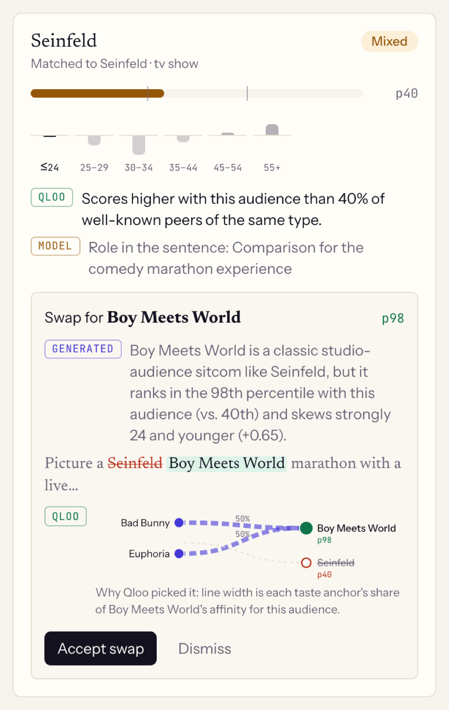</td>
</tr>
<tr>
<td valign="top">

**3. Taste on a timeline.** In the Dial Test, Qloo percentiles are placed on the exact words where each reference is spoken, so you hear and watch Olive Garden sink and Kali Uchis land.

</td>
<td>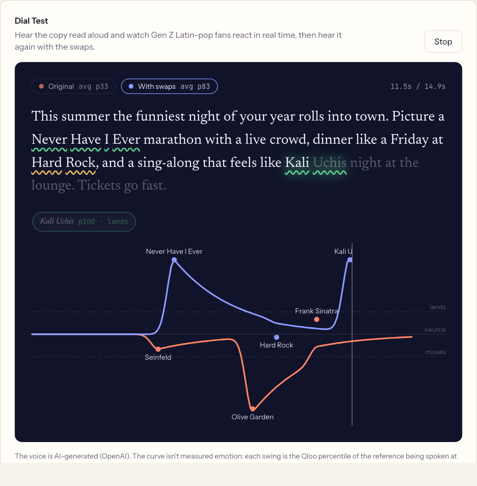</td>
</tr>
<tr>
<td valign="top">

**4. Audiences you can read.** Predicted commenters are built from Qloo: each one's favourite artist, show, film and brand comes from Qloo for this audience, and how they react to each reference has to match its Qloo score.

</td>
<td>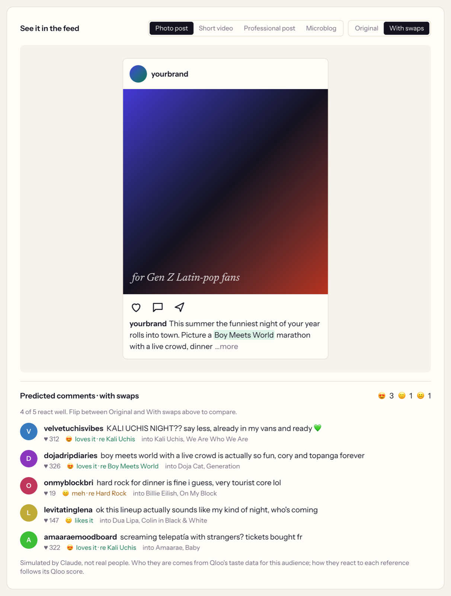</td>
</tr>
<tr>
<td valign="top">

**5. Heatmaps for creative placement.** Qloo's locality heatmaps, drawn from Qloo's own neighbourhood boundaries, compare where an audience lives with where each reference's fans live: Kali Uchis reaches 8 of Gen Z Latin-pop fans' 10 strongest Chicago neighbourhoods; Seinfeld reaches none.

</td>
<td>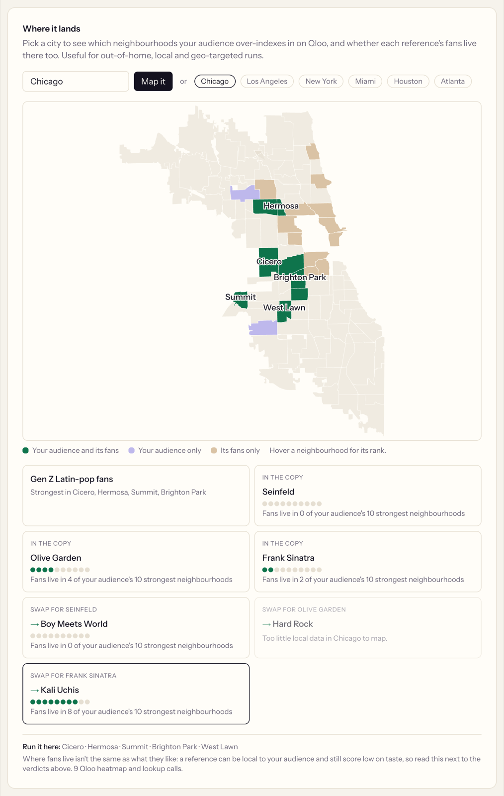</td>
</tr>
<tr>
<td valign="top">

**6. A dictionary between audiences.** The Culture Translator scores one reference for five audiences and, where it misses, finds the Qloo-verified equivalent that plays the same role: in the run shown, Seinfeld becomes *Sex Education* for Gen Z Latin-pop fans and *Insecure* for 30–34 hip-hop heads, and already lands with 55+ classic-rock fans.

</td>
<td>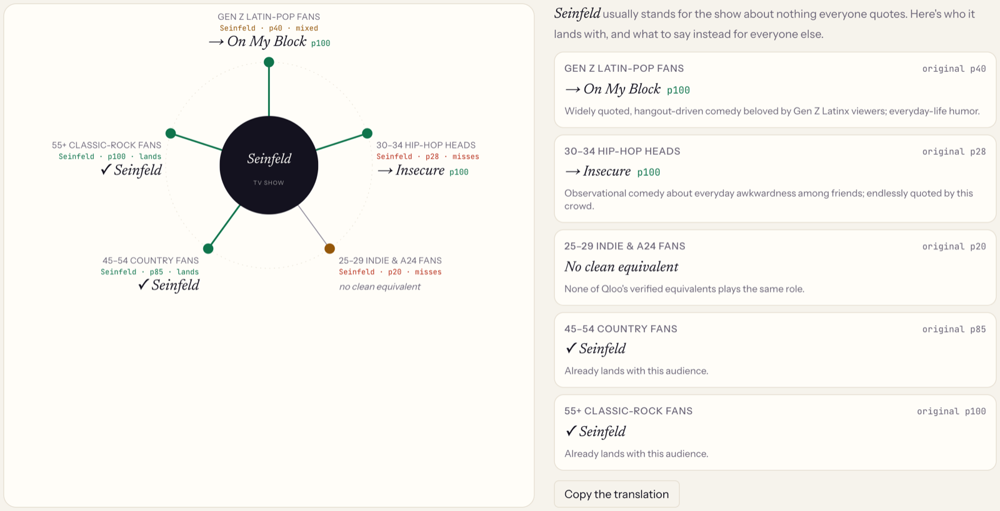</td>
</tr>
<tr>
<td valign="top">

**7. One grid for a whole campaign.** Campaign check scores every version of an ad for every audience in a single pass per audience, so an agency sees which version runs where: in the example, the classic-rock route wins with 55+ fans, the Latin-pop route with Gen Z (helped by naming Bad Bunny and *Euphoria*, that audience's own anchors, which score p100 by definition), and the indie route doesn't even win with indie fans.

</td>
<td>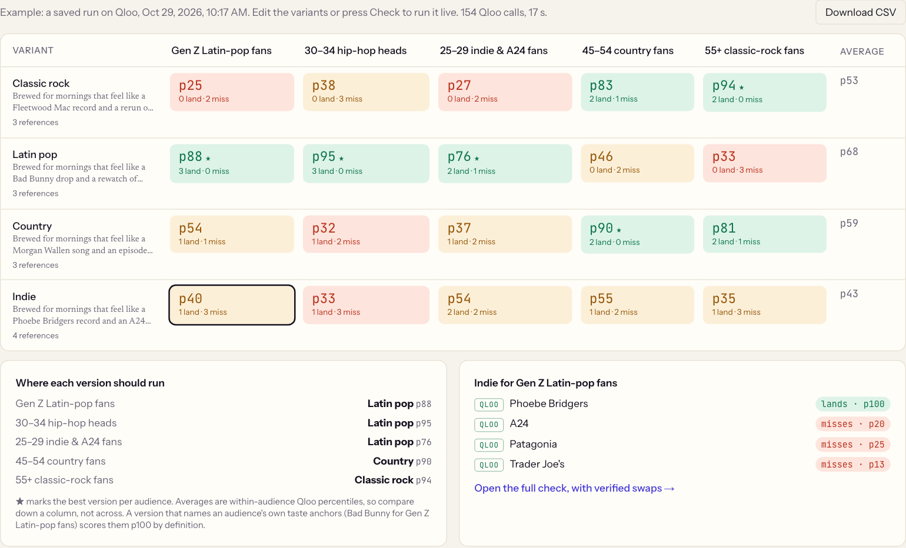</td>
</tr>
<tr>
<td valign="top">

**8. Qloo as the referee, checked from outside.** The benchmark uses Qloo to grade Claude alone against Vernacular on the same copy and briefs, and shows what a model does without taste data: it repeats the audience's own examples back. Because Qloo grades its own suggestions there, a non-Claude model also rates recognition blind, and that check changed how swaps are picked.

**9. Taste in every text box and every agent.** The same Qloo-backed check runs in a browser extension on any page, and as MCP tools any AI agent can call before it publishes.

</td>
<td>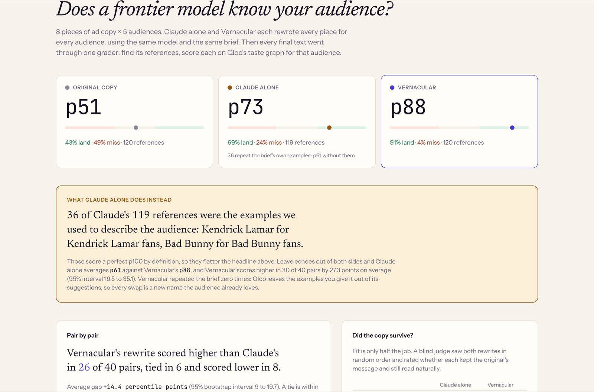<br />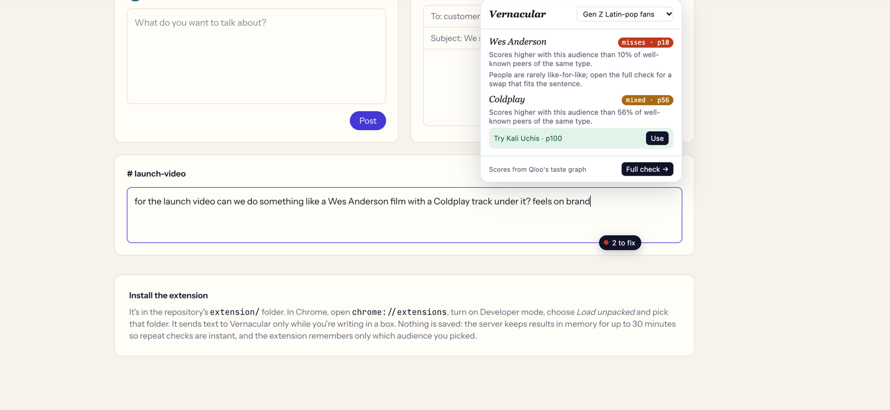</td>
</tr>
</table>

## Screenshots

| | |
|---|---|
| 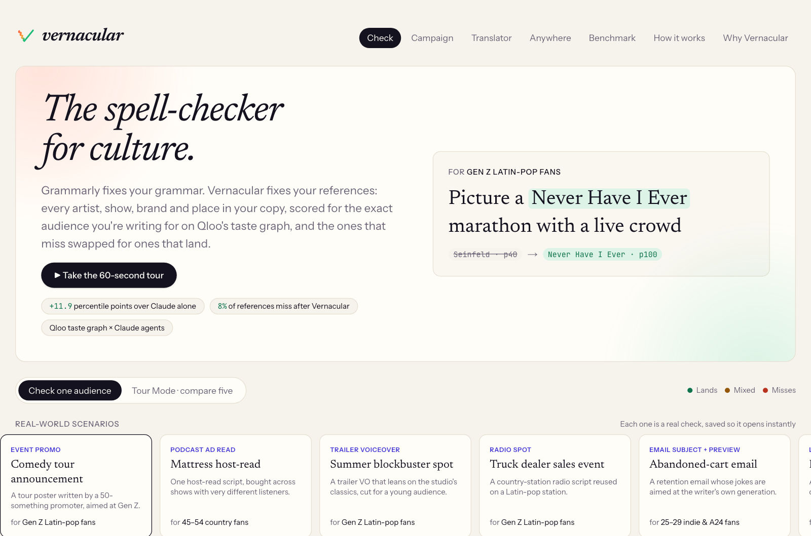 | 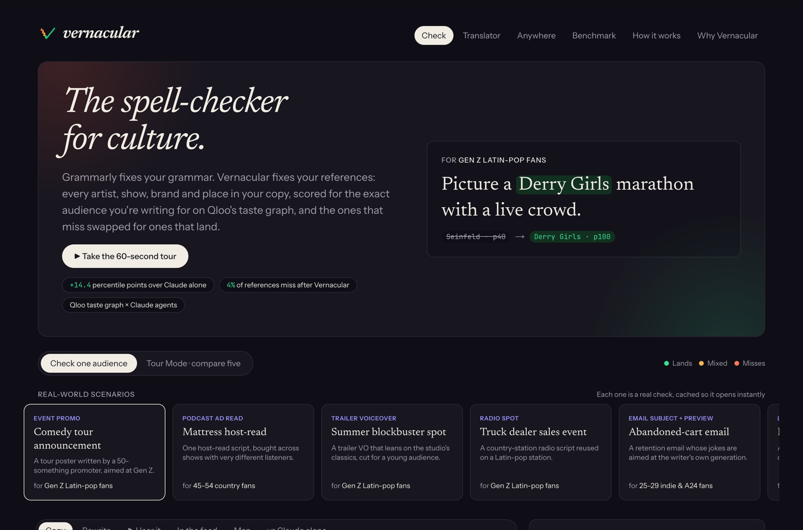 |
| **Home.** A ticker of real swaps from the gallery, twelve one-click scenarios and a guided tour. | **Dark mode.** Every page has a light and a dark theme. |
| 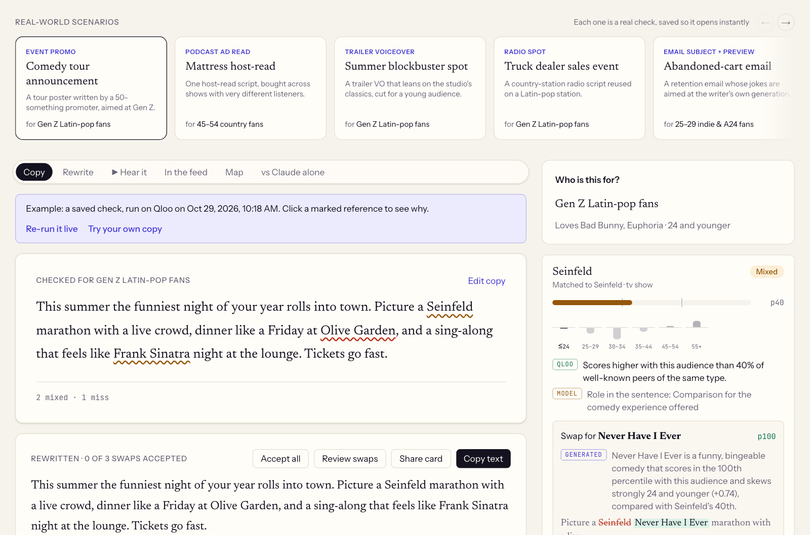 | 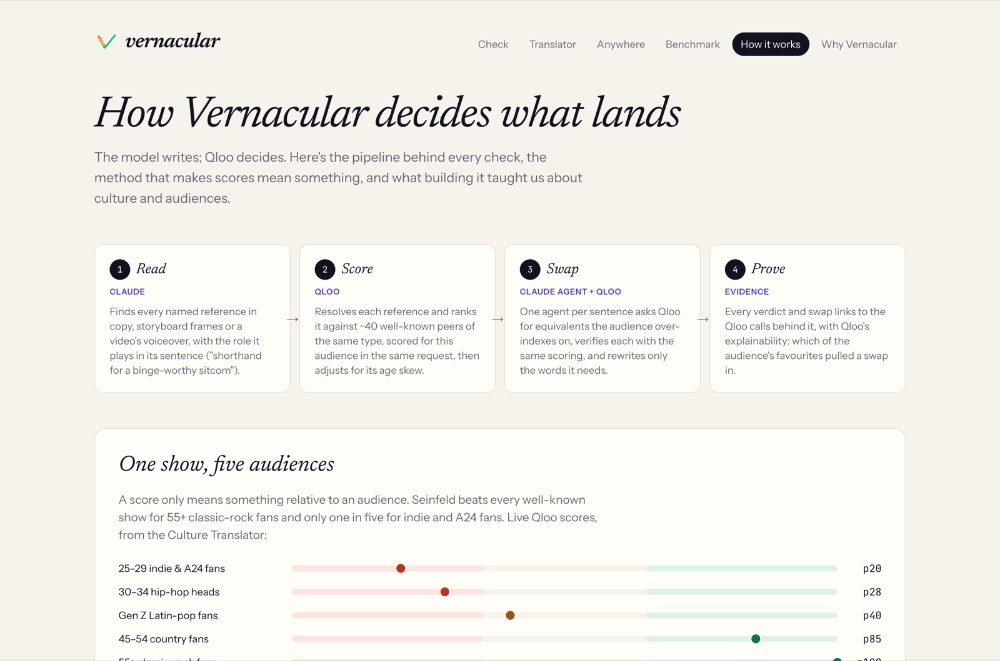 |
| **A check.** Proof marks on each reference, Qloo evidence per card, and a bar to jump between results. | **How it works.** The pipeline, one show's standing across five audiences, and what we learned. |

## Features

| Feature | What it does |
|---|---|
| **Check** | Copy in, every reference marked lands / mixed / misses with the Qloo evidence behind it, verified swaps you accept or dismiss one by one. |
| **Real-world scenarios** | Twelve one-click cases across formats (event promo, podcast read, trailer voiceover, radio spot, email, launch post, short-video caption, Chicago billboard, App Store blurb, charity appeal, Spanish promo, LinkedIn post), each a real check saved with its date so it opens instantly, and re-runnable live. |
| **Guided tour** | A 60-second walkthrough of the best moments for first-time visitors. |
| **Your checks** | Your recent checks, kept only in this browser, reopen instantly with their before and after scores. |
| **Dial Test** | The copy read aloud (AI voice, disclosed) while a reaction curve swings to each reference's Qloo percentile as it is spoken; then the swapped version. Words are timed by transcribing the generated audio. |
| **Predicted comments** | Five simulated commenters whose favourites come from Qloo for this audience, reacting in line with each reference's score, before and after swaps. Labelled as simulated. |
| **Where it lands** | Qloo locality heatmaps: the neighbourhoods of a city where the audience over-indexes, and how many of them each reference's fans also live in, drawn from Qloo's own boundaries. |
| **Culture Translator** | One reference scored for five audiences; where it misses, the verified equivalent that plays the same role. A resonance radar plots the reference's Qloo percentile per audience over the misses / mixed / lands bands and morphs into the translated shape; each audience is a button linked to its card. Opens on a saved Seinfeld run. |
| **Tour Mode** | The same copy against two to five audiences side by side. |
| **Campaign check** | Up to five versions of an ad × up to five audiences in one grid: each version's average Qloo percentile per audience, the best version for each audience, and every cell one click from the full check with swaps. Imports a CSV; exports one. |
| **Audience from a sentence** | A plain description becomes Qloo audience segments (from `/v2/audiences`), interest tags, anchors and, when stated, a gender skew, with a cross-domain fingerprint. |
| **Storyboards and video** | Frames are sampled in the browser; Claude reads on-screen brands, settings and text; the voiceover is transcribed and each line attached to its frame. |
| **Social layer** | Shareable result cards with social previews, swipe review of swaps, and a feed preview that marks the fold. |
| **Claude alone comparison** | The same model and brief without Qloo, scored the same way, side by side with Vernacular. |
| **Vernacular Anywhere** | A Chrome extension: a culture-check pill on any text box, one-click swaps that Undo can reverse (each must share Qloo tags with the original, so a coffee chain is swapped for a coffee chain), and a link into the full check. |
| **MCP server** | Six tools for any agent: `check_copy`, `build_audience`, `compare_audiences`, `check_campaign`, `where_it_lands`, `translate_reference`. |

## How it uses Qloo

Vernacular would not work without Qloo: the model writes, Qloo decides what lands. These are the Qloo endpoints the app calls at runtime:

| Qloo request | Parameters used | Powers |
|---|---|---|
| `GET /search` | `query`, `types`, `take`; matches checked against the name and Qloo's alternative names (`akas`) | Resolving every reference, anchor and candidate |
| `GET /v2/insights` (scoring) | `filter.type`, `filter.results.entities`, `signal.interests.entities`, `signal.demographics.age`, `signal.demographics.gender`, `signal.demographics.audiences`, `signal.interests.tags` | Scores for the references and a reference panel in the same request, so they're comparable |
| `GET /v2/insights` (panel) | `filter.type`, `filter.popularity.min`, `take=40`; `filter.location.query` for places in a city | The well-known peers a reference is ranked against |
| `GET /v2/insights` (candidates) | `feature.explainability`, `filter.tags`, `filter.exclude.entities`, `filter.popularity.min` | Swap candidates, and which anchors drove each one |
| `GET /v2/insights` (demographics) | `filter.type=urn:demographics` | Age skew that can downgrade a verdict |
| `GET /v2/insights` (location) | `signal.location.query` | Place and brand scores for an audience in a city |
| `GET /v2/insights` (heatmap) | `filter.type=urn:heatmap`, `filter.location.query`, `output.heatmap.boundary=urn:entity:locality` | Neighbourhood maps from Qloo's polygons |
| `GET /v2/audiences` | `filter.audience.types`, `take` | The segment catalogue for plain-language audiences |
| `GET /v2/tags` | `filter.query` | Role-preserving swaps ("sitcom", "crooner") and interest tags |

### A real trace

The saved landing sample (*Gen Z Latin-pop fans*: anchors Bad Bunny and *Euphoria*, age 24 and younger), run on 2026-10-29: 27 Qloo calls (2 resolve the audience's anchors; the 25 behind the verdicts and swaps are listed in the app), 7 Claude calls, 43 seconds. IDs are shortened here.

```text
GET /search?query=Seinfeld&take=3&types=urn:entity:tv_show
GET /v2/insights?filter.popularity.min=0.85&filter.type=urn:entity:tv_show&take=40        ← reference panel (fetched once per type per server, then reused)
GET /v2/insights?filter.results.entities=<Seinfeld, panel…>&filter.type=urn:entity:tv_show
                &signal.demographics.age=24_and_younger&signal.interests.entities=<Bad Bunny, Euphoria>&take=41
GET /v2/insights?filter.type=urn:demographics&signal.interests.entities=<Seinfeld>        ← age skew
GET /v2/insights?feature.explainability=true&filter.exclude.entities=<Seinfeld>&filter.popularity.min=0.85
                &filter.tags=urn:tag:genre:qloo:comedy,urn:tag:genre:media:comedy
                &filter.type=urn:entity:tv_show&signal.demographics.age=24_and_younger
                &signal.interests.entities=<Bad Bunny, Euphoria>&take=8                    ← candidates
GET /v2/insights?filter.results.entities=<3 candidates, panel…>&filter.type=urn:entity:tv_show&…&take=43   ← verify
…

Seinfeld      → mixed  p40   "Scores higher with this audience than 40% of well-known peers of the same type."
Olive Garden  → misses p0
Frank Sinatra → mixed  p60   "Its audience over-indexes for 24 and younger (+0.35)."

Seinfeld      → Never Have I Ever  p100  shares Comedy, Dating, Friendship, Humorous
Olive Garden  → Hard Rock          p48   mixed, but 48 points above the original; shares Dining, Hospitality
Frank Sinatra → Kali Uchis         p100  shares Love, Heartbreak, Nostalgia
```

Every Qloo call behind a result is listed in the app: open **"Qloo calls back what you see here"** under any check.

## Architecture

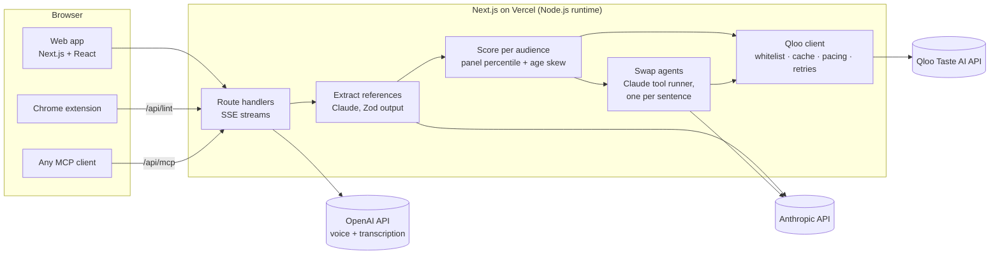

A check, step by step:

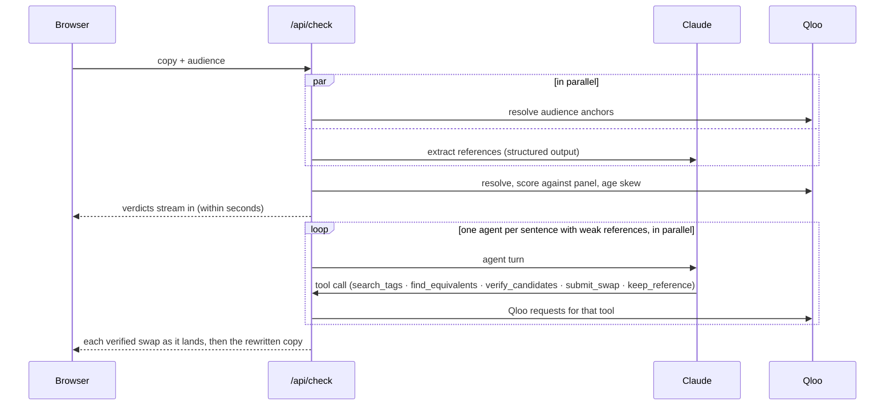

## Engineering notes

**The swap agent.** Built on the Anthropic SDK's tool runner with Zod-typed tools. Rules are enforced in the tools, not just the prompt:

- a candidate must have come from Qloo in this run;
- it must verify as landing, or be mixed and at least 15 points above the original;
- the rewritten sentence must name it (or its usual acronym) and no longer contain the original;
- each run has a cap of 16 model turns and 40 Qloo calls.

The prompt adds judgment the data can't make: keep references that state a fact (credits, venues, where something is sold), prefer household names when a reference is a yardstick ("funnier than X"), and switch type when like-for-like can't fill the role (a film for a director).

**Scoring.** A reference's affinity is compared with ~40 well-known entities of the same type scored in the same Qloo request. That makes scores comparable within one audience, which raw affinity isn't. With a city set, places are ranked among that city's well-known places, and anything still short of a comparison set is scored on taste alone, with a note saying so.

**Qloo client** (`src/lib/qloo/client.ts`):

- a parameter whitelist, because Qloo silently ignores unknown parameters;
- response caching (1 hour) and sharing of identical in-flight requests;
- at most three requests in flight, spaced to stay under the key's 5-requests-per-second limit;
- retries that honour `Retry-After`;
- a name-plausibility check, so a made-up name never borrows a real entity's score.

**Reliability:**

- Streams results as they're ready.
- Runs one agent per sentence in parallel.
- Queues requests for up to 20 seconds when an instance is busy, instead of failing.
- Serves the landing sample, gallery scenarios and example campaign from saved checks in the repository, so they open instantly; a live check, cached for a day, is the fallback if an example changes.
- Strips unused Qloo tags from everything sent to the browser.
- Offers a ready-made example when a check fails.

**Front end:** React 19 Server and Client Components, Tailwind CSS v4 with light and dark themes, and SVG visualisations drawn by hand (no chart or map libraries): the Dial Test curve, the translator's resonance radar, taste paths and neighbourhood maps. Animations respect reduced-motion settings.

## Evidence

**Benchmark.** Run with `npm run benchmark`, then `npm run benchmark:recognition`; results at [`/benchmark`](https://vernacular-lime.vercel.app/benchmark), every pair browsable. It covers 8 pieces of original ad copy × 5 audiences, run on the current code on 2026-10-29. Each pair is written three ways: the original, Claude alone (same model and brief, no Qloo) and Vernacular. Every final text is graded by one pass (extract, then score on Qloo), a blind Claude judge for meaning and fluency, and an outside recognition judge from a different model family.

| | Original | Claude alone | Vernacular |
|---|---|---|---|
| Mean percentile (Qloo) | p51 | p73 | **p85** |
| References that miss (Qloo) | 49% | 25% | **8%** |
| Recognition, outside judge (/5) | 3.11 | 4.13 | 3.69 |
| Recognition, brief examples left out (/5) | 3.11 | 3.75 | 3.69 |
| Meaning kept (blind judge, /5) | | 4.75 | 4.60 |
| Reads naturally (blind judge, /5) | | 4.70 | 4.55 |

- Vernacular scored higher than Claude alone on Qloo in 24 of 40 pairs, tied in 8 and lower in 8 (+11.9 points on average, 95% bootstrap interval 5.6 to 17.9).
- 36 of Claude alone's references simply repeated the audience examples from the brief (Bad Bunny for Bad Bunny fans), which score p100 on Qloo by definition. Leaving those out of both sides, the gap is +27.0 points (17.9 to 35.8).
- **The outside check.** Qloo is both Vernacular's source and the grader, so `gpt-5.5` (not Claude, which wrote the Claude-alone versions) rated every reference, blind to which version used it: would this audience recognise it and like it? With the brief's examples left out, Vernacular and Claude alone are level (+0.03 per pair, −0.19 to +0.26). Counting them, Claude alone leads.
- That check changed the product. On the Oct 20 run it showed Vernacular's swaps were often real Qloo favourites few people would know (*The Knick* for country fans). Swaps must now be at least as well-known as the peers they're ranked against; recognition rose from 3.56 to 3.69 at a cost of three percentile points (p88 to p85). The full before and after is in [docs/FINDINGS.md](docs/FINDINGS.md#outside-recognition-check-oct-29).
- 43% of Vernacular's references and 47% of Claude alone's score p100, the top of the scale, where percentiles can't separate them.
- Fluency is the trade: Vernacular's rewrites are rated a little lower on meaning and naturalness than Claude alone's.

**Validated before it was built.** Before writing the product we tested whether Qloo's audience-conditioned affinity can tell which references land, with thresholds written into the scripts in advance. The first test failed, and showed that raw affinity can't be compared across audiences; a confirmatory test on new references and audiences then passed all three thresholds (88% of within-audience pairs ordered correctly). Vernacular's percentile scoring is built on that result. Log and scripts: [docs/FINDINGS.md](docs/FINDINGS.md).

**Edge cases.** `npm run edge-cases -- --full` runs 16 cases live against Claude and Qloo, each with its expectation written in the script:

- no references, and generic nouns
- possessives, hashtags and handles, misspellings, emoji
- *Atlanta* the show vs the city, and Spanish copy
- prompt injection inside the copy
- made-up names
- the audience's own anchor
- a repeated name
- older references for a young audience
- swaps that keep Spanish copy in Spanish
- a factual credit that must not be swapped

All 16 pass ([latest output](docs/evidence/edge-cases.txt)).

**Unit tests.** 75 tests in 13 files (`npm test`): parameter whitelisting, scoring verdicts, the diff engine, share tokens, the benchmark statistics, Dial Test alignment, name plausibility, map geometry, payload slimming, the role check behind swaps (shared Qloo tags), the article guard, campaign cells and CSV import.

**Load.** `scripts/load-test.ts` fires simultaneous fresh checks as distinct visitors. Five at once on one local production server all completed: first scores in 8–10 seconds, all finished within 36 seconds ([output](docs/evidence/load-test.txt)).

**Accessibility.** `npm run a11y` runs axe-core 4.14 (WCAG 2.1 A and AA rules plus best practices) in Chromium on the seven main pages, in the light and the dark theme, and checks that each fits a 375 px screen without sideways scrolling. All 14 pass ([output](docs/evidence/a11y.txt)).

**CI.** GitHub Actions runs lint, typecheck, the unit tests, a production build and the accessibility audit (the saved checks let every page render without API keys) on every push to `main`, and scans the full git history for leaked keys with gitleaks.

## Known limitations

What the results do and don't establish:

- **Qloo grades its own suggestions in the benchmark.** Percentiles measure distance from what Qloo's data says about an audience, not human reactions. The outside recognition check uses a model from another family (OpenAI), which is independent of both Qloo and Claude but is still a model, not a human panel.
- **Percentiles top out.** A reference that beats every well-known peer scores p100, so a share of results sit at the ceiling and can't be told apart; the benchmark page reports that share per version.
- **Over-indexing isn't recognition.** Qloo's affinity says an audience likes something more than the average person does, not that most of them know it. Swaps must be at least as well-known as the panel they're ranked against (popularity 0.85); the agent can lower that only when nothing at the default fits the role.
- **Explainability is thin with two anchors.** The preset audiences have two taste anchors, and Qloo splits credit between them almost evenly, so cards explain a swap with the Qloo tags it shares with the original instead, and draw the anchor split only when it differs.
- **Audiences are descriptions, not customer data.** An audience is taste anchors, an age band and optional Qloo segments, interest tags, gender skew and city, not a brand's first-party segments.
- **Reference finding is model-based.** Claude can miss a reference or misread its role. The 16 edge cases cover the failure modes we found, not every possible input.
- **Language and place.** English and Spanish copy are tested; other languages aren't. City-local scoring applies to places and brands. The map shows where an audience and a reference's fans live, which is about placement, not taste.
- **Simulated and saved content is labelled.** Predicted comments are written by Claude from Qloo data, not real people. Gallery examples are saved runs (with the date shown); "Re-run it live" runs the same copy fresh, and live runs can pick different swaps.
- **Aggregate, not personal.** Qloo affinities describe audiences in aggregate. Nothing here says anything about an individual.
- **Demo limits.** Twelve full checks per IP every ten minutes; the hackathon Qloo key has its own rate and monthly limits.

## Tech stack

| Layer | Choice (version) |
|---|---|
| Framework | Next.js 15.5 (App Router, Node.js runtime route handlers), React 19.1 |
| Language | TypeScript 5 |
| Styling | Tailwind CSS 4; Newsreader, Instrument Sans and JetBrains Mono via `next/font` |
| Taste data | Qloo Taste AI API (hackathon host) |
| Language model | Anthropic Claude `claude-opus-5-5` via `@anthropic-ai/sdk` 0.135 (structured outputs, tool runner) |
| Voice | OpenAI `gpt-4o-mini-tts` (Dial Test voice) and `whisper-1` (word and segment timestamps) |
| Agents | Model Context Protocol server, `@modelcontextprotocol/sdk` 1.32, Streamable HTTP |
| Validation | Zod 4 |
| Images | `next/og` for share cards |
| Testing | Vitest 5; live edge-case, load and benchmark scripts; Playwright 1.64 with axe-core 4.14 for accessibility |
| CI and hosting | GitHub Actions, Vercel |

## Project structure

```text
vernacular/
├── src/
│   ├── app/                      # Next.js App Router
│   │   ├── page.tsx              # Check (home)
│   │   ├── translate/            # Culture Translator
│   │   ├── anywhere/             # Extension demo
│   │   ├── campaign/             # Campaign check
│   │   ├── benchmark/            # Benchmark results
│   │   ├── how/                  # How it works
│   │   ├── pitch/                # Why Vernacular
│   │   ├── c/[token]/            # Shared result page
│   │   └── api/                  # Route handlers (see HTTP API)
│   ├── components/               # UI: workbench, Dial Test, map, compass, tour…
│   └── lib/
│       ├── qloo/                 # Qloo client, parameter whitelist, tools, geometry, name matching
│       └── vernacular/           # Extraction, scoring, swap agent, campaign, translator, comments, voice,
│           ├── benchmark/        #   lint, scenarios; benchmark corpus, grader, judges, stats, results
│           ├── snapshots/        #   saved gallery, landing and campaign checks (npm run snapshot)
│           └── __tests__/        # Unit tests
├── extension/                    # Chrome extension (Manifest V3)
├── public/                       # Extension script for the demo page, sample storyboard and animatic
├── scripts/                      # CLI check, benchmark, data tests, edge cases, load test, a11y, snapshots, MCP smoke
├── docs/brand/                   # Logo files
├── docs/screenshots/             # README screenshots
├── docs/evidence/                # Saved output of the a11y audit, edge cases and load test
├── docs/FINDINGS.md              # Pre-registered data tests and the outside recognition check
├── docs/CLAIMS.md                # Each claim in the submission and what backs it
└── .github/workflows/ci.yml      # Lint, typecheck, tests, build
```

## HTTP API

All routes are `POST` with JSON unless noted. Streaming routes send server-sent events.

| Route | Purpose |
|---|---|
| `/api/check` (SSE) | Full check: extract, score, swap |
| `/api/campaign` (SSE) | Up to 5 variants × 5 audiences, one audience column at a time |
| `/api/tour` (SSE) | Score one copy for 2–5 audiences |
| `/api/translate` (SSE) | One reference across five audiences |
| `/api/lint` | Fast check for the extension (CORS open) |
| `/api/audience` | Plain-language audience → Qloo signals |
| `/api/baseline` | Claude alone, scored the same way |
| `/api/map` | Neighbourhood heatmaps for a city |
| `/api/comments` | Predicted comments |
| `/api/voice` | AI voice with word timings |
| `/api/storyboard` | Read storyboard or video frames |
| `/api/transcribe` | Voiceover transcription (multipart) |
| `GET /api/sample`, `GET /api/scenario/:id`, `GET /api/campaign/sample` | Saved example checks (live and cached for a day if the example has changed) |
| `GET /api/card?d=…` | Share-card image |
| `/api/mcp` (GET, POST, DELETE) | MCP server |

Requests are rate-limited per IP in memory (12 checks per 10 minutes).

## Use it from an agent (MCP)

The server speaks MCP over Streamable HTTP at `https://vernacular-lime.vercel.app/api/mcp`. For example, in Claude Code:

```bash
claude mcp add --transport http vernacular https://vernacular-lime.vercel.app/api/mcp
```

Tools: `check_copy`, `build_audience`, `compare_audiences`, `check_campaign`, `where_it_lands`, `translate_reference`. To try them against a local server, run `npm run mcp:smoke`.

## Browser extension

1. Run `npm run build:extension`. This copies the shared script into `extension/`.
2. In Chrome, open `chrome://extensions` and turn on **Developer mode**.
3. Choose **Load unpacked** and pick the `extension/` folder.
4. Click into any text box and start writing. Pick your audience from the extension's toolbar button.

It calls the hosted app and sends text only while you're writing in a box. See [Data and privacy](#data-and-privacy).

## Run it locally

**You need:**

- Node.js 22.9 or newer, with npm. We develop on 22.23; `.nvmrc` pins 22. Install from [nodejs.org](https://nodejs.org) or a version manager (nvm, fnm, nvm-windows).
- Git.
- A Qloo hackathon API key and an Anthropic API key. An OpenAI key is optional: without it, everything except the Dial Test voice and video voiceover transcription works.

### macOS and Linux

```bash
git clone https://github.com/TusharTechs/vernacular.git
cd vernacular
npm install
cp .env.example .env.local
# edit .env.local and add your keys
npm run dev
```

### Windows (PowerShell)

```powershell
git clone https://github.com/TusharTechs/vernacular.git
cd vernacular
npm install
Copy-Item .env.example .env.local
# edit .env.local (for example: notepad .env.local) and add your keys
npm run dev
```

In Command Prompt, use `copy .env.example .env.local` instead of `Copy-Item`.

Then open http://localhost:3000.

### Environment variables

| Variable | Required | Used for |
|---|---|---|
| `QLOO_API_KEY` | Yes | Every Qloo call |
| `QLOO_BASE_URL` | Yes (prefilled) | `https://hackathon.api.qloo.com`; hackathon keys work only on this host |
| `ANTHROPIC_API_KEY` | Yes | Extraction, the swap agent, storyboards, comments, translator |
| `OPENAI_API_KEY` | No | Dial Test voice, video voiceover transcription, sample-media voiceover, the benchmark's recognition judge |
| `NEXT_PUBLIC_SITE_URL` | No | Absolute URLs for share previews when not on Vercel |
| `VERNACULAR_AGENT_EFFORT` | No | `low` (default) or `medium` effort for the swap agent |
| `QLOO_DISK_CACHE` | No | Scripts only: a folder for caching Qloo responses on disk |
| `QLOO_RETRY_BASE_MS` | No | Base delay for Qloo retries (default 500 ms; tests set it low) |
| `VERCEL_PROJECT_PRODUCTION_URL` | No | Set by Vercel; used for absolute share-preview URLs |

### Scripts

| Command | What it does |
|---|---|
| `npm run dev` | Development server on port 3000 |
| `npm run build` then `npm start` | Production build and server |
| `npm test` | Unit tests |
| `npm run lint` · `npm run typecheck` | ESLint and TypeScript checks |
| `npm run check -- tour` | One check in the terminal, printing each step (also `coffee`) |
| `npm run qloo:smoke` | Live sanity check of the Qloo key and host |
| `npm run edge-cases` | Live adversarial suite (`-- --full` adds the two swap cases) |
| `npm run benchmark` | Re-runs the benchmark. Qloo responses are cached on disk; Claude calls are not, so it costs Claude usage |
| `npm run benchmark:recognition` | Adds the outside recognition ratings (OpenAI) to the benchmark results |
| `npm run qloo:data-test` · `npm run qloo:confirm-test` | The day-1 pre-registered data tests ([docs/FINDINGS.md](docs/FINDINGS.md)) |
| `npm run snapshot` | Re-saves the landing sample, the twelve scenarios and the example campaign, then rebuilds the home ticker |
| `npm run a11y -- <url>` | axe-core audit and 375 px check of the main pages |
| `npm run screenshots -- <url>` | Re-captures the README screenshots |
| `npx tsx scripts/load-test.ts http://localhost:3000 5` | Simultaneous fresh checks |
| `npm run mcp:smoke` | Calls the local MCP server like an agent would |
| `npm run build:extension` | Prepares `extension/` |
| `npm run warm -- <url>` | Fills a deployment's caches (landing sample and all scenarios) so first visitors don't wait |

`scripts/make-sample-media.py` regenerates the sample storyboard and animatic. It's optional and needs Python 3, ffmpeg and Google Chrome at the default macOS path.

**Troubleshooting.**

- `401` from Qloo: check that `QLOO_BASE_URL` is the hackathon host.
- `429`: Qloo's per-second limit was hit. The client retries on its own; wait a moment if it persists.
- First checks take 30–60 seconds while caches are cold.

## Deploying

The live demo runs on Vercel and deploys automatically from `main`. To deploy your own copy, import the repository in Vercel and add the environment variables above. No other configuration is needed. After a deploy, `npm run warm -- https://your-deployment` fills the server caches so the gallery opens instantly.

## Data and privacy

- **No database.** The app doesn't save the text you check; server logs record only error messages.
- **Sent to third parties:**
  - your text goes to Anthropic (Claude);
  - reference names and audience signals go to Qloo;
  - for the Dial Test and video transcription, text or audio goes to OpenAI.
- **Held in server memory to avoid repeat work, never saved:**
  - Qloo responses, for up to 1 hour;
  - quick-check results, for 30 minutes;
  - generated voice audio, until evicted.
- **Saved in the repository:** checks of our own sample copy only (the landing sample, the twelve scenarios and the example campaign), as names, scores, verdicts, swaps and the Qloo call log.
- **Share links** carry names and scores in the URL itself; nothing is stored for them.
- **Rate limiting** keeps request times per IP address in memory for 10 minutes.
- **The repository** contains no raw Qloo responses (`.cache/` is git-ignored). The benchmark and the saved checks publish derived names, percentiles, verdicts and texts.

## AI disclosure

We used AI tools heavily, in building Vernacular and inside the product.

**Building it.** Claude Code, Anthropic's coding agent running Claude Opus 5.5, was used throughout:

- researching the Qloo API and the hackathon rules, and planning;
- writing and refactoring the code, tests and scripts;
- running and analysing experiments (the benchmark, edge cases, load tests) and debugging;
- writing the documentation, this README and the sample copy;
- designing the logo, which is an SVG path drawn in code, with no image-generation model.

The author directed the work, made the product decisions, reviewed the results, and provided the accounts and API keys.

**Inside the product:**

- **Anthropic Claude** (`claude-opus-5-5`) reads copy and frames, runs the swap agent, picks translations, writes the simulated comments, and is the benchmark's blind fidelity judge.
- **OpenAI** `gpt-4o-mini-tts` reads copy aloud in the Dial Test, and `whisper-1` transcribes voiceovers. Both are labelled in the interface.
- **OpenAI** `gpt-5.5` is the benchmark's outside recognition judge (not part of the product).
- **The sample animatic's voiceover, and the demo video's narration,** are AI-generated (OpenAI text-to-speech). The animatic's storyboard panels were drawn as SVG in code.
- **Predicted comments** are simulated by Claude and labelled as such. They are not real people.

What is not generated by a model: every audience score, verdict and percentile comes from Qloo's Taste AI API, and every swap is verified against Qloo before it is suggested.

## License

[MIT](LICENSE)
